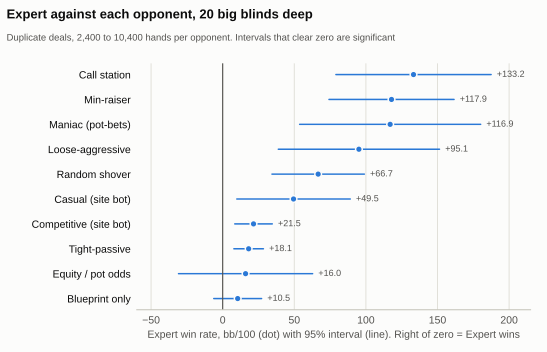
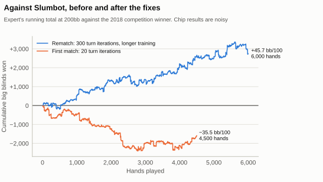
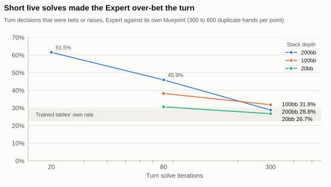
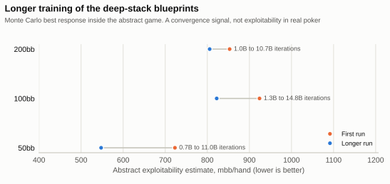

# Benchmarks

Every number here was measured. Raw results are in [`research/results/`](../research/results), and the tables come from [`research/scripts/make_report.py`](../research/scripts/make_report.py), which also writes the data behind the [results page](https://book15011.github.io/poker/how-it-works.html#benchmarks).

## Summary

191,178 hands were evaluated: 68,678 head-to-head, 112,000 against Local Best Response and 10,500 against Slumbot.

- **Against the hand-written bots, the Expert wins, significantly at 20bb**: +21.5 ± 13.1 bb/100 against the Competitive bot on the site, and +18.1 ± 10.3 against Tight-passive. At 100bb every result is positive, but most intervals are still too wide.
- **Local Best Response never beat it.** At 100bb and 200bb the Expert did measurably better against LBR than the same blueprint without live solving. That is the clearest evidence the solver earns its place: it makes the bot more robust, more than it wins extra chips from these opponents.
- **Longer training helped inside the abstract game, less in real poker.** The deep blueprints ran 11 to 16 times as many iterations. Their convergence estimates fell 6 to 24%, and each beats its predecessor in the abstract game. In real poker only the 100bb gain is measurable (+9.0 ± 7.5 bb/100), and Local Best Response finds no difference in robustness. The 100bb and 50bb tables on the site are now the longer-trained ones ([details](#longer-deep-stack-training)).
- **Against Slumbot it lost the first match and won the rematch.** The first match went −35.5 ± 50.6 bb/100 over 4,500 hands. The logs showed the Expert betting the turn twice as often as it should, which traced back to short turn solves. After that fix and a longer 200bb training run, the rematch went +45.7 ± 47.1 over 6,000 hands. That interval only just reaches zero, and Slumbot is a much more heavily trained bot, so the fair reading is that the Expert now holds its own, not that it is clearly stronger. Slumbot took about 250,000 core hours to compute; this project's training has used about 220 in all.

## Setup

- **Code under test:** the same JavaScript and WebAssembly that ship to the browser, run in Node.js 26. Benchmarks import `poker/js` directly.
- **Expert settings:** turn solves of 30 to 40 Discounted CFR iterations, river solves of 200 to 250, modelling every 4th river card on the turn. The browser instead uses a time budget, and on a laptop typically gets about 60 turn and 380 river iterations, so these figures slightly understate the deployed bot.
- **Variance reduction:** each deck is played twice with seats swapped (duplicate deals), and the reported result is the mean of each pair. Intervals are 95% normal-approximation intervals over pairs.
- **Seeds:** every job takes a seed on the command line, and the jobs files are in `research/results/`. Rerunning a job with the same seed replays the same decks and the same decisions.
- **Hardware:** AMD EPYC 7542 (shared server, 12 of 16 cores, low priority) for benchmarks and training. Browser timings on a Windows laptop in Chrome.

## Opponents

| Opponent | Kind | Description |
|---|---|---|
| Blueprint only | Ablation | The same trained tables on every street, with no live solving. This isolates what the solver adds |
| Competitive | Site bot | Hand-written: equity against a random hand, discounted when the opponent bets, plus position, texture and mixing |
| Casual | Site bot | Over-calls, under-bluffs |
| Tight-passive, Loose-aggressive, Equity / pot odds, Call station, Random | Baselines | Classic styles |
| Maniac, Min-raiser, Random shover | Stress tests | Built to probe weak points: constant pot bets, odd minimum raises, random all-ins |
| Local Best Response | Exploiter | Given the exact strategy, attacks it greedily ([Lisý & Bowling 2017](https://arxiv.org/abs/1612.07547)) |
| Slumbot | Independent | 2018 Annual Computer Poker Competition winner, over its public API. The only opponent here that I did not write |

None of these were used to train the Expert, which learned only from self-play. Every opponent is therefore held out.

## Results at 20 big blinds

This is the stack depth the quick match on the site starts at.

<picture>
  <source media="(prefers-color-scheme: dark)" srcset="figures/head_to_head_20bb-dark.svg">
  
</picture>

| Expert against | Hands | bb/100 | 95% CI |
|---|---|---|---|
| Blueprint only | 9,600 | +10.5 | ±16.7 |
| Equity / pot odds | 2,400 | +16.0 | ±46.8 |
| Tight-passive | 10,400 | +18.1 | ±10.3 |
| Competitive (site bot) | 10,400 | +21.5 | ±13.1 |
| Casual (site bot) | 2,400 | +49.5 | ±39.6 |
| Random shover | 2,400 | +66.7 | ±32.2 |
| Loose-aggressive | 2,400 | +95.1 | ±56.3 |
| Maniac | 2,400 | +116.9 | ±63.2 |
| Min-raiser | 2,400 | +117.9 | ±43.6 |
| Call station | 2,400 | +133.2 | ±54.2 |
| Random | 2,400 | +142.6 | ±35.8 |

What this shows:

- The Expert wins clearly against the weaker styles and against all three stress tests. Odd bet sizes and constant aggression don't break it.
- Against the two strongest hand-written bots, the edge is about 0.2 big blinds per hand. That is small but significant over 10,400 hands each. Short stacks leave less room for skill, because many hands end preflop.
- **Live solving vs the blueprint alone: +10.5 ± 16.7.** The interval includes zero, so in head-to-head play I can't claim the solver adds measurable strength at this depth. Its value shows up against LBR instead (below), and in handling bets the blueprint never saw.

## Quick matches

The format on the site: 2,000 chips each, blinds rising every 5 hands, first to 3,000 wins.

| Expert against | Matches | Expert wins | 95% CI | Hands per match |
|---|---|---|---|---|
| Casual (site bot) | 240 | 52.9% | ±6.3 | 4.9 |
| Competitive (site bot) | 240 | 65.8% | ±6.0 | 9.0 |
| Tight-passive | 240 | 67.9% | ±5.9 | 10.6 |

Against Casual, matches last under five hands, because that bot calls all-ins with half its hands. That makes most matches close to coin flips, even though the Expert's per-hand edge against it is large. A short match is mostly luck, and the site says so.

## Local Best Response

LBR is told the exact strategy, then attacks it greedily, assuming the hand checks down after its action. If LBR won, that would prove a minimum amount the bot can be exploited by. The table shows how much the bot won against LBR, using the convention of the [ReBeL paper](https://arxiv.org/abs/2007.13544): **positive means the attack failed.**

| Agent | Stack | LBR plays from | Hands | Agent wins (mbb/hand) | 95% CI |
|---|---|---|---|---|---|
| Blueprint only | 20bb | preflop | 20,000 | +123 | ±119 |
| Expert | 20bb | preflop | 4,000 | +53 | ±272 |
| Blueprint only | 20bb | turn | 20,000 | +513 | ±141 |
| Expert | 20bb | turn | 2,000* | +954 | ±461 |
| Blueprint only | 100bb | preflop | 20,000 | +765 | ±367 |
| Expert | 100bb | preflop | 3,000 | +1,410 | ±955 |
| Blueprint only | 100bb | turn | 20,000 | +806 | ±367 |
| Expert | 100bb | turn | 1,500* | +2,922 | ±1,595 |
| Blueprint only | 200bb | turn | 20,000 | +1,980 | ±581 |
| Expert | 200bb | turn | 1,500* | +5,566 | ±2,680 |

\* Stopped early, because live solving at every LBR decision runs at about 0.5 hands per second. The row uses the last progress report, and every value in it is already well above zero.

For scale, the ReBeL paper reports ReBeL beating LBR by 881 ± 94 and DeepStack by 383 ± 112, when LBR had to call through preflop and flop at 200bb (the "turn" rows here). Note that the Expert and blueprint rows are not identical tests: LBR may only bet sizes that exist in the agent's own tree, and the live solver's menu differs from the blueprint's.

In no setting did LBR find a positive bound. At 100bb and 200bb the Expert beat LBR by clearly more than the blueprint alone did, with intervals that don't overlap. That is evidence that live solving makes the bot harder to exploit. It is not proof: LBR is a weak attacker that tries a few bet sizes and assumes the hand checks down afterwards.

## Results at 100 big blinds

This is the Deep stacks mode on the site.

| Expert against | Hands | bb/100 | 95% CI |
|---|---|---|---|
| Blueprint only | 6,000 | +10.4 | ±45.8 |
| Competitive (site bot) | 1,200 | +45.9 | ±90.6 |
| Tight-passive | 1,200 | +55.8 | ±79.1 |
| Casual (site bot) | 1,200 | +104.4 | ±166.4 |
| Equity / pot odds | 1,200 | +108.4 | ±179.2 |
| Loose-aggressive | 1,200 | +199.3 | ±224.8 |
| Call station | 1,200 | +287.9 | ±170.9 |

Deep stacks swing much more, and live solving is slower, so these samples are smaller. Every point estimate is positive, but only the Call station result is significant. I treat this table as consistent with the 20bb results, not as further proof.

## Slumbot

[Slumbot](https://slumbot.com) won the 2018 Annual Computer Poker Competition. Its authors report about 250,000 core hours and 2 TB of RAM to compute it. It plays 200bb deep through a public API, so this is the one test against a strong bot I didn't write. Each session plays one request at a time (`research/bench/slumbot.js`). The Expert uses its 200bb blueprint for preflop and flop, and live solving after that.

There were two matches:

- **First match**, 3 sessions of 1,500 hands: the first 200bb blueprint (1.0 billion iterations), with 20 turn and 150 river solve iterations.
- **Rematch**, 3 sessions of 2,000 hands (`research/scripts/slumbot_rematch.sh`): the longer-trained 200bb blueprint (10.7 billion iterations, see [Training](#training)), with 300 turn and 600 river iterations. That is the most the site runs while you take your time to act.

<picture>
  <source media="(prefers-color-scheme: dark)" srcset="figures/slumbot-dark.svg">
  
</picture>

| Match | Scoring | Hands | bb/100 | 95% CI | mbb/hand |
|---|---|---|---|---|---|
| First | Raw chips | 4,500 | −35.5 | ±50.6 | −355 |
| First | All-in adjusted (12 hands) | 4,500 | −44.2 | ±47.8 | −442 |
| Rematch | Raw chips | 6,000 | +45.7 | ±47.1 | +457 |
| Rematch | All-in adjusted (10 hands) | 6,000 | +49.3 | ±44.6 | +493 |

The all-in adjusted rows score hands where both players were all-in before the river at their expected value over the remaining cards. That is a standard way to remove some luck, and it uses the same hands. The sessions show how noisy deep-stacked hands are: +22, −557 and −531 mbb/hand in the first match, and +739, −204 and +835 in the rematch. Each match's sessions ran side by side, so the chart interleaves them hand by hand.

| Street | First match: Expert | First match: Slumbot | Rematch: Expert | Rematch: Slumbot |
|---|---|---|---|---|
| Preflop | 42.4% | 54.3% | 47.0% | 52.6% |
| Flop | 36.0% | 26.0% | 27.2% | 28.9% |
| Turn | 51.8% | 21.4% | 27.7% | 26.9% |
| River | 31.8% | 27.4% | 32.3% | 30.4% |

Share of each player's decisions that were bets or raises (`research/bench/slumbot_actions.py`). In the first match the Expert bet the flop and especially the turn far more often than Slumbot. In the rematch it is close on every street. The hands that ended with an Expert turn raise or turn all-in cost 18.9 bb/100 in the first match, and 3.2 in the rematch.

**Reading it honestly:**

- The rematch is a win of 45.7 bb/100, but its interval runs from about −1 to +93, so it only just fails to rule out a loss. The all-in adjusted interval, from about +5 to +94, clears zero.
- The difference between the two matches is about 2.3 standard errors, so the improvement itself is unlikely to be luck. The rematch changed two things at once, longer training and longer solves, so this test can't say how much each one contributed.
- For scale, published wins against Slumbot run from 1.1 ± 0.5 bb/100 (Modicum) and 4.5 ± 0.5 (ReBeL) to 17.6 ± 4.4 (Supremus, over 150,000 hands), all with far more compute (see [RESEARCH.md](RESEARCH.md)). A true edge of 45 bb/100 would be surprising, and the real margin is most likely much smaller. The fair conclusion is that the Expert at these settings plays Slumbot about evenly, or better, not that it is a stronger bot.
- On the site the Expert gets these iteration counts only while you think. When it acts first on the turn, it has its 1.5 s budget, about 60 iterations on a laptop, so the deployed bot is somewhat weaker than the one in the rematch. The site's games are also at most 100bb deep, so it never uses the 200bb blueprint; the 100bb and 50bb blueprints got the same longer training (see [Training](#training)).

## Turn aggression and solve length

`research/bench/slumbot_actions.py` splits the Slumbot logs by street and by each hand's last aggressive action. In the first match, hands that ended with an Expert turn raise cost 9.9 bb/100, and turn all-ins another 9.0, out of the 35.5 lost. To test whether short solves cause the extra aggression, `research/bench/turn_profile.js` plays the Expert against the blueprint alone (duplicate deals, 300 pairs, 150 for the slowest run) and counts every action by street:

<picture>
  <source media="(prefers-color-scheme: dark)" srcset="figures/turn_aggression-dark.svg">
  
</picture>

| Depth | Turn iterations | Expert: turn bets and raises | Blueprint: turn bets and raises | Expert vs blueprint (bb/100) |
|---|---|---|---|---|
| 200bb | 20 | 61.5% | 23.8% | +196.6 ± 220.7 |
| 200bb | 80 | 45.9% | 27.7% | +123.6 ± 206.7 |
| 200bb | 300 | 28.8% | 29.4% | +50.6 ± 208.5 |
| 100bb | 80 | 38.2% | 27.1% | +29.0 ± 138.2 |
| 100bb | 300 | 31.8% | 27.4% | +48.0 ± 152.1 |
| 20bb | 80 | 30.6% | 24.5% | +47.6 ± 67.2 |
| 20bb | 300 | 26.7% | 22.5% | +30.8 ± 66.2 |

River iterations were scaled with the turn (150, 400 and 600). Deep stacks need the most iterations: at 200bb, 20 iterations leave the Expert betting or raising more than twice as often as the trained tables, and by 300 it matches them. A likely reason is that an under-converged average strategy still carries the early, nearly uniform iterations, and most options in a deep tree are bets and raises. Dropping actions under 15% instead of 2% only moved 200bb at 80 iterations from 45.9% to 38.9%, and 100bb from 38.2% to 36.2%, so the fix is more iterations, not more pruning.

The win rates against the blueprint don't show this: every interval includes zero. A passive, exploitable opponent may even pay off the extra bets, which is a reason to judge the fix on a strong opponent instead. The earlier head-to-head benchmarks used 30 to 40 turn iterations, so their Expert was also more aggressive than intended. They were not rerun.

**What changed on the site.** The Expert now keeps solving while you decide, up to 300 turn and 600 river iterations, and answers from that solve if your action is in its tree (see [ARCHITECTURE.md](ARCHITECTURE.md#expert-turn-and-river)). When it acts first on the turn it still has its 1.5 s budget, about 60 iterations on a laptop. The [Slumbot rematch](#slumbot) used 300 and 600, and the Expert's turn aggression came down from 51.8% to 27.7%, in line with Slumbot's 26.9%.

## Training

Blueprints were trained one stack depth at a time on 12 CPU threads. The exploitability estimate is a Monte Carlo best response *inside the abstract game*. It tracks convergence, and it is not the bot's exploitability in real poker. See [TRAINING.md](TRAINING.md).

| Depth | Abstraction (flop / turn / river buckets) | Minutes | Iterations | Abstract exploitability estimate (mbb/hand) |
|---|---|---|---|---|
| 5bb | 2,000 / 5,000 / 5,000 | 5 | 3.21B | about 0 (within noise) |
| 8bb | 2,000 / 5,000 / 5,000 | 8 | 3.32B | 25 |
| 12bb | 2,000 / 5,000 / 5,000 | 15 | 2.70B | 85 |
| 20bb | 2,000 / 5,000 / 5,000 | 30 | 2.89B | 134 |
| 30bb | 2,000 / 5,000 / 5,000 | 30 | 1.27B | 149 |
| 50bb | 2,000 / 1,000 / 1,000 | 45 | 0.68B | 723 |
| 100bb | 2,000 / 1,000 / 1,000 | 60 | 1.27B | 924 |
| 200bb | 2,000 / 1,000 / 1,000 | 60 | 1.01B | 853 |

The deep blueprints were far less converged: their trees are 5 to 30 times larger, and the first runs had about an hour each. That is the main reason the bot does live solving on the turn and river, and it was the clearest place to spend more compute. A 5-minute trial at 20bb measured 293 mbb/hand, against 134 after 30 minutes on a finer abstraction.

### Longer deep-stack training

`research/scripts/deep_long.sh` resumed the three deep blueprints from their checkpoints on 12 threads: 200bb for 6 more hours, 100bb for 5 and 50bb for 2.5 (see [TRAINING.md](TRAINING.md#step-5-train-longer-from-a-checkpoint)). Afterwards, `research/scripts/long_bench.sh` compared each new blueprint with the one it replaced. Raw results are in [`research/results/long_bench/`](../research/results/long_bench) and [`research/results/training_long/`](../research/results/training_long).

<picture>
  <source media="(prefers-color-scheme: dark)" srcset="figures/training-dark.svg">
  
</picture>

| Depth | Minutes (first + longer) | Iterations | Abstract exploitability estimate (mbb/hand) | New vs first, abstract game (bb/100) | New vs first, real game, tables only (bb/100) |
|---|---|---|---|---|---|
| 50bb | 45 + 150 | 0.68B to 10.98B | 723 to 548 | +3.2 ± 0.2 | −1.4 ± 5.9 |
| 100bb | 60 + 300 | 1.27B to 14.82B | 924 to 822 | +3.7 ± 0.2 | +9.0 ± 7.5 |
| 200bb | 60 + 360 | 1.01B to 10.70B | 853 to 806 | +6.3 ± 0.3 | +7.3 ± 9.7 |

The two head-to-head columns use duplicate deals. The abstract game is the one the blueprints were trained in (`train h2h`). The real game plays both sets of trained tables on every street in real No-Limit Hold'em, with the same bet translation as the site, over 200,000 hands per depth (`research/bench/bp_compare.js`). Intervals are 95%.

Local Best Response, with the same seeds and ten times the hands of the first measurement. The numbers are the bot's win rate against LBR, so positive means the attack failed:

| Blueprint | LBR plays from | Hands | First run (mbb/hand) | Longer run (mbb/hand) |
|---|---|---|---|---|
| 100bb | Preflop | 200,000 | +804 ± 118 | +642 ± 116 |
| 100bb | Turn | 200,000 | +987 ± 117 | +961 ± 116 |
| 200bb | Turn | 200,000 | +2,013 ± 182 | +1,918 ± 178 |

The site's own configuration, the Expert with live solving (80 turn and 400 river iterations), new blueprint against old at 100bb, came out at −31.9 ± 87.6 bb/100 over 1,200 hands. That is far too few hands to say anything either way.

**Reading it honestly:**

- Inside the abstract game, the longer runs are clearly better. Every exploitability estimate fell, by 24% at 50bb, 11% at 100bb and 6% at 200bb, and every new blueprint beats the one it replaced by a margin many standard errors wide.
- In real poker the gain is smaller and only partly visible. The new 100bb tables beat the old ones by 9.0 ± 7.5 bb/100, just outside noise. At 200bb the edge is similar but within noise, and at 50bb there is no measurable difference.
- LBR still never wins against either version. It does slightly better against the new tables in all three settings, by 26 to 162 mbb/hand, but each difference is within the noise of the two runs. So this test shows no gain in robustness from the extra training, and no clear loss either.
- One likely reason the real-game gains are small is the abstraction itself. With 1,000 turn and river buckets, more iterations converge toward the equilibrium of a coarse game, and the bot keeps that game's blind spots. The fixes in [RESEARCH.md](RESEARCH.md), a finer or potential-aware abstraction, matter more now than more iterations.

**What changed on the site.** The 100bb and 50bb tables are now the longer-trained ones. The site's games never reach 200bb, so that blueprint is used only by the Slumbot benchmark.

## Solver quality and speed

**Turn solves, judged on the full game.** Each candidate's turn strategy was pinned in a full 48-river tree, river play was solved given it, and exploitability was measured there (`research/bench/solver_quality.js`). Values are exploitability as a percentage of the pot, on a laptop:

| Board | Rivers modelled | 250 ms | 500 ms | 1,000 ms |
|---|---|---|---|---|
| Rainbow | all 48 | 47.0% | 15.3% | 6.2% |
| Rainbow | every 2nd | 15.4% | 7.3% | 2.5% |
| Rainbow | every 4th | 7.6% | 2.7% | 1.3% |
| Two-tone | all 48 | 26.1% | 13.3% | 5.8% |
| Two-tone | every 4th | 11.3% | 4.7% | 2.1% |
| Paired | all 48 | 51.2% | 27.5% | 10.7% |
| Paired | every 4th | 9.4% | 2.9% | 1.3% |

Modelling a stratified quarter of the rivers wins at every budget, because far more iterations fit. Keeping every 6th or 8th card is faster still, but bottoms out at 2 to 4%. Random river *sampling* that changes on each iteration was also tried, and was clearly worse (about 5% at 2 s, against 0.17% for full traversal), so it was dropped.

**Correctness.** The solver reproduces the known equilibrium of a classic river toy game: bet all value, bluff with half the air for a pot-sized bet, and call half the time with a bluff-catcher (`poker/tests/solver.test.js`).

**Speed in Chrome** (`research/e2e/perf.py`, 30 hands):

| | Mean |
|---|---|
| Model and solver load, after download | 84 ms |
| Preflop decision (table lookup) | 17 ms |
| Flop decision (table lookup) | 10 ms |
| Turn decision (live solve, 1.5 s budget) | 1.27 s, about 61 iterations |
| River decision (live solve, 0.7 s budget) | 0.42 s, about 385 iterations |

With CPU throttling (main thread, since Chrome's throttling does not reach workers): about 11 turn iterations in 1.5 s at 4×, and 6 to 7 at 6×. Throttling is a rough stand-in for a phone, not a measurement on one. On slow devices the bot automatically models fewer rivers and drops very unlikely hands.

## Artifact sizes

| File | Size (gzip) | Used for |
|---|---|---|
| `flop_buckets.bin.gz` | 827 KB | Flop card abstraction, all depths |
| `bp_5`, `bp_8`, `bp_12`, `bp_20` | 88 to 809 KB each | Quick match |
| `bp_30`, `bp_50`, `bp_100` | 1.4 to 6.5 MB each | Deep stacks |
| `solver.wasm` | 50 KB | Live solver |

A quick match downloads about 2.2 MB the first time a visitor plays Expert, and nothing before that. The portfolio page itself loads none of this.

## Correctness tests

| Check | Result |
|---|---|
| 7-card category counts over all 133,784,560 hands | Exact match in JS and C++ |
| JS and C++ evaluator hash over the same enumeration | Identical (3124877938) |
| Browser bucket lookups against the trainer's | 0 mismatches in 20,000 random samples |
| Rules engine unit tests (blinds, minimum raises, short all-ins, refunds, splits) | Pass |
| Property test: 40,000 random hands with random stacks and blinds | Chips conserved, every action legal, every hand terminates |
| Fuzz: every bot including Expert, random stacks and blinds | No illegal action |
| Browser end-to-end at desktop and phone sizes, including the Quant page modal and every existing page | Pass, no console errors |

## Known limitations

- Against Slumbot, an independent and much more heavily trained bot, the rematch win (+45.7 ± 47.1 bb/100) is a small sample and only just clears zero after the all-in adjustment. It shows the Expert roughly holds its own, not that it is stronger.
- Live solving shows no significant head-to-head gain over the blueprint alone. Its measured benefit is robustness against LBR.
- The deep blueprints are still far from converged, even after the longer runs (abstract estimates of 548 to 822 mbb/hand), and their coarse turn and river abstraction now limits them more than training time does.
- 100bb head-to-head samples are small.
- The solver uses estimated ranges and a small set of bet sizes, and has no safety guarantee.
- No AIVAT. Duplicate deals reduce variance, but far less than AIVAT would.
- No tests against human players.
